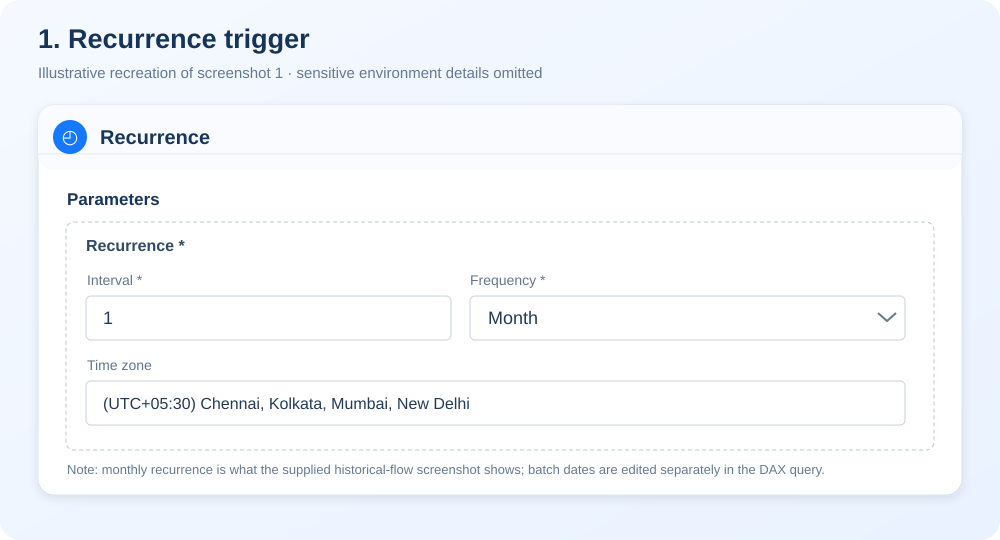
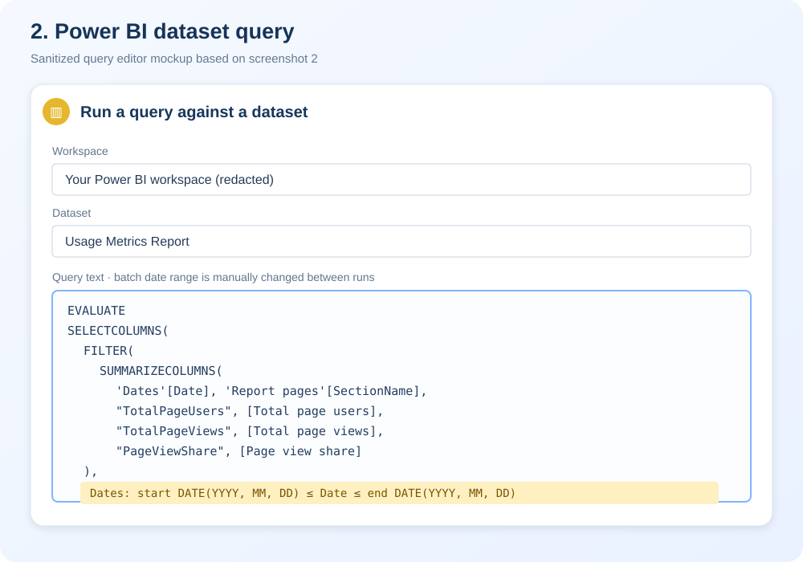
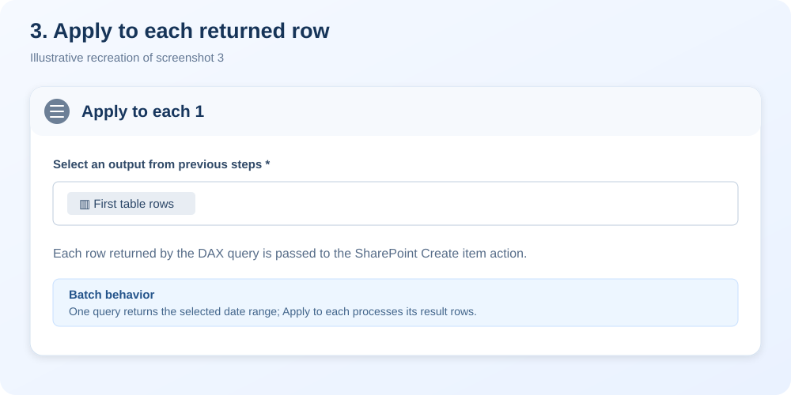
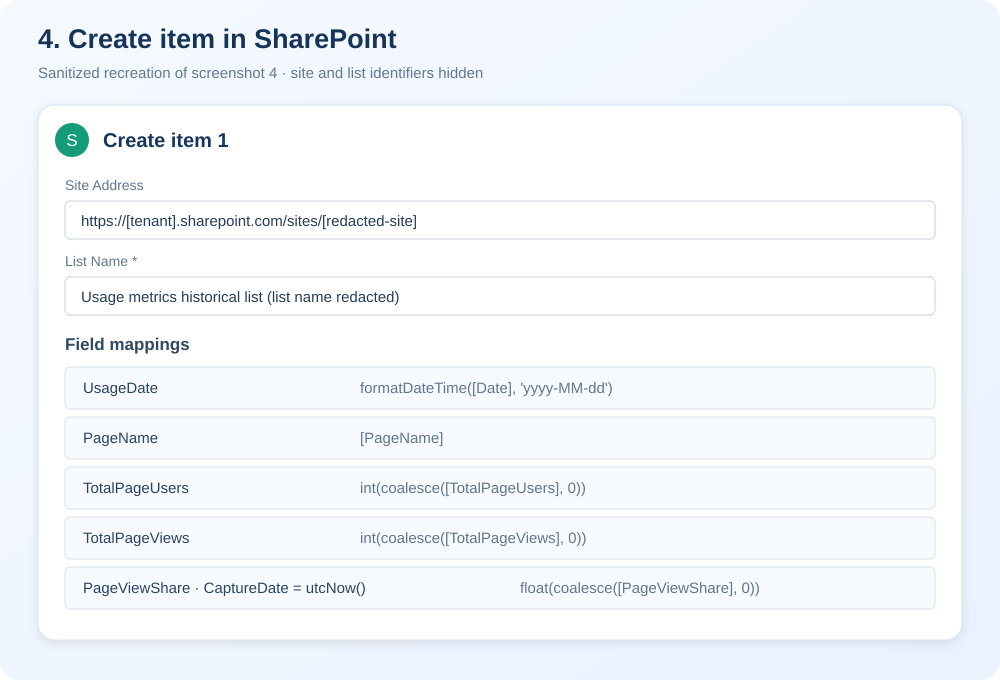
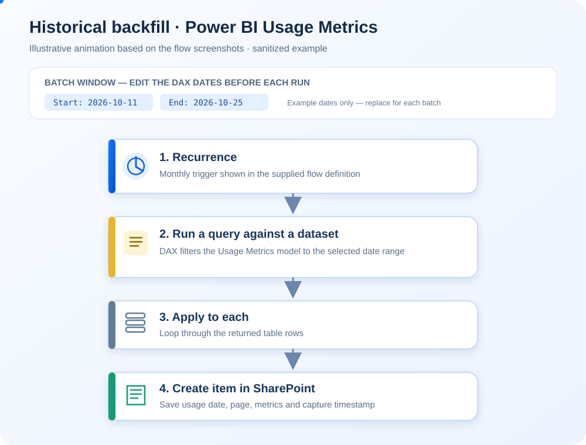

# Power BI Usage Metrics — Historical & Daily Capture

Preserve Power BI report usage analytics beyond the default rolling Usage Metrics window using Power Automate and SharePoint.

## Historical backfill flow

The following illustrations are privacy-safe recreations of all four screenshots supplied for the first flow. They are explanatory mockups, not original screenshots; tenant, site and list identifiers are omitted.

### 1. Recurrence settings

### 2. Power BI dataset and DAX query

### 3. Apply to each

### 4. SharePoint Create item and field mappings

### Animated end-to-end flow

[Open the animated flow illustration](docs/images/historical-backfill-flow.svg) · [Read the batch-by-batch guide](docs/historical-backfill-batches.md)

## Two-flow design

1. **Historical backfill** — run controlled date-range batches to seed the SharePoint list with older usage data.
2. **Daily incremental capture** — scheduled daily; queries the previous day and checks whether a page/date row already exists before inserting it.

The repository contains sanitized JSON examples derived from the flow definitions shared by the project author. They are reference examples, not drop-in deployment packages. They do not contain connection credentials and replace tenant-specific identifiers with placeholders.

## Repository structure

- [`flows/historical-backfill.json`](flows/historical-backfill.json) — sanitized historical flow example.
- [`flows/daily-incremental-capture.json`](flows/daily-incremental-capture.json) — sanitized daily flow example.
- [Historical batch procedure](docs/historical-backfill-batches.md) — how to edit the date range and run batches safely.
- [SharePoint schema](docs/sharepoint-schema.md) — suggested list columns.
- [`.gitignore`](.gitignore) — common local/secret exclusions.

## Prerequisites

- Power Automate cloud flow authoring access.
- Power BI connector permission to query the Usage Metrics semantic model.
- SharePoint access to create and read list items.
- A SharePoint list with columns matching the mappings in the examples.

## Setup

1. Create the SharePoint list using the [schema guide](docs/sharepoint-schema.md).
2. In each flow, configure Power BI and SharePoint connector connections in your own environment.
3. Replace placeholders for workspace ID, semantic model ID, site URL, list ID, and connection references. Keep actual IDs and connection details out of this public repository if they reveal internal configuration.
4. For historical backfill, follow the [batch-by-batch procedure](docs/historical-backfill-batches.md). Run and validate each date range before moving to the next.
5. For daily capture, configure the recurrence time and verify that `TODAY() - 1` matches the semantic model's date context and your intended time zone.
6. Test on a short date range, validate row counts and metrics, and check SharePoint duplicate behavior before enabling the schedule.
7. Review flow run history and periodically reconcile captured dates and totals against Power BI Usage Metrics.

## Important caveats

- The supplied historical definition has a monthly trigger and a fixed date range. It is not automatically a full backfill until you configure the date windows and run all required batches.
- The daily flow checks for an existing record by page name and usage date. If your model has multiple rows per page/date, the uniqueness key must include the additional dimensions. Consider using a stable key and a SharePoint unique column for stronger idempotency.
- The daily flow uses UTC scheduling but DAX `TODAY()` follows the semantic model's evaluation context. Validate the date boundary carefully.
- SharePoint OData filters can require date-format adjustments and escaping for page names containing apostrophes. Test these cases.
- User-level identifiers can be sensitive. The historical query includes a user key, but its supplied SharePoint create action does not store it. Keep that field out unless required and authorized.
- Flow JSON copied from a code view may not be a complete importable Power Automate package; connector bindings must be set up separately.
- Power BI, Power Automate, and SharePoint service limits can affect batch size and run time.

## License

Check the repository's existing license before reusing or redistributing the project.
