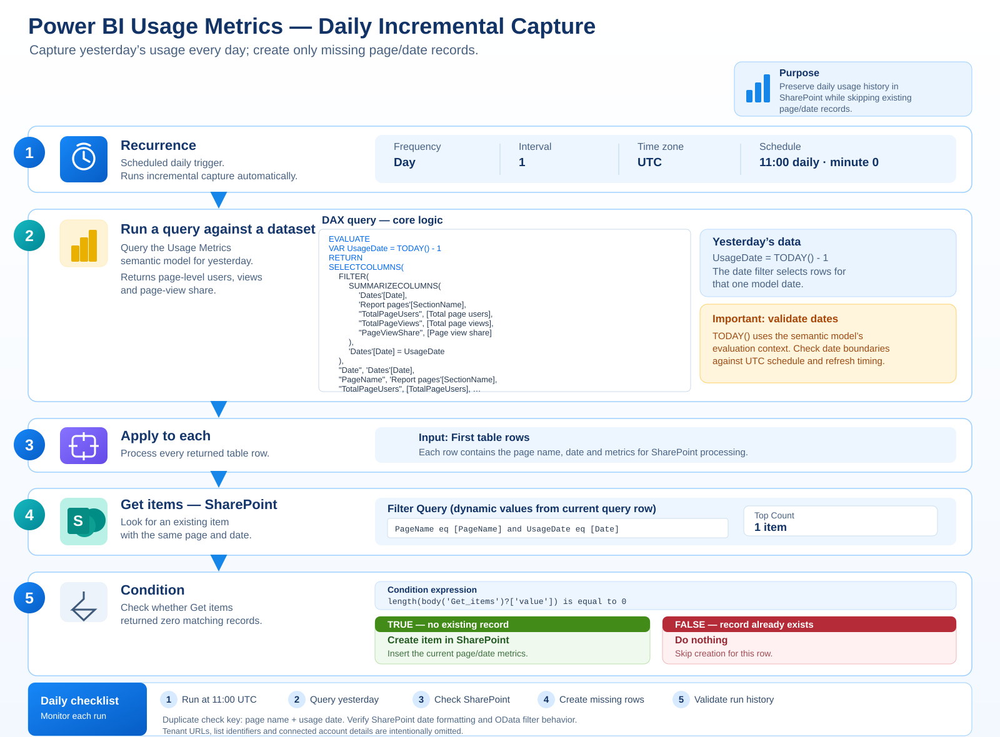

# Daily incremental capture flow

 This captures the previous day's Power BI Usage Metrics and creates a SharePoint list item only when a matching page/date item is not found.

## Flow illustration



## How the flow works

1. **Recurrence** — runs every day at 11:00 UTC (the screenshot shows interval `1`, frequency `Day`, hour `11`, minute `0`). The start time shown in the original screenshot is environment-specific and should be configured for your own flow.
2. **Run a query against a dataset** — executes the DAX query below and returns usage metrics for yesterday.
3. **Apply to each** — loops through the query's first table rows.
4. **Get items** — queries the SharePoint list using the current row's `PageName` and `Date`, with **Top Count = 1**.
5. **Condition** — checks whether `length(body('Get_items')?['value'])` equals `0`.
6. **True branch** — if no matching record exists, **Create item** inserts the row into SharePoint.
7. **False branch** — if a matching record already exists, no action is taken.

## Full DAX query

Copyable version of the query you supplied:

```dax
EVALUATE
VAR UsageDate = TODAY() - 1
RETURN
SELECTCOLUMNS(
    FILTER(
        SUMMARIZECOLUMNS(
            'Dates'[Date],
            'Report pages'[SectionName],
            "TotalPageUsers", [Total page users],
            "TotalPageViews", [Total page views],
            "PageViewShare", [Page view share]
        ),
        'Dates'[Date] = UsageDate
    ),
    "Date", 'Dates'[Date],
    "PageName", 'Report pages'[SectionName],
    "TotalPageUsers", [TotalPageUsers],
    "TotalPageViews", [TotalPageViews],
    "PageViewShare", [PageViewShare]
)
```

### Query behavior

- `UsageDate = TODAY() - 1` selects yesterday relative to the semantic model's evaluation context.
- The query groups results by date and page name, then returns total page users, total page views, and page-view share.
- Unlike the historical backfill query, this query does not include `UserKey`; its output is page-level rather than user-level.
- Validate the semantic model's refresh time and date context against the flow's 11:00 UTC schedule. `TODAY()` is not guaranteed to match the intended local date boundary in every setup.

## SharePoint duplicate check

The **Get items** action shown in the screenshots uses a filter equivalent to:

```text
PageName eq '<current PageName>'
and UsageDate eq '<current Date>'
```

In the flow designer, insert the dynamic content tokens for the current query row's `PageName` and `Date`; don't type the angle-bracket placeholders literally. Set **Top Count** to `1`.

The condition is:

```text
length(body('Get_items')?['value']) is equal to 0
```

- **True:** create a SharePoint item.
- **False:** no action.

### Important filter considerations

- The SharePoint date value must be formatted consistently with the `UsageDate` column. If `UsageDate` is a date-only column, test the exact OData filter format expected by your connector.
- Page names containing apostrophes may need escaping in the OData filter. Test unusual page names.
- This duplicate check is only as reliable as its matching key and filter. If your intended grain includes more dimensions than page/date, include those dimensions in the key.
- Two overlapping flow runs can both find no item and then create duplicates. For stronger protection, consider a deterministic key and a SharePoint column configured to enforce unique values.

## SharePoint Create item field mapping

| SharePoint column | Value |
|---|---|
| `UsageDate` | `formatDateTime(item()?['[Date]'], 'yyyy-MM-dd')` |
| `PageName` | Current row's `[PageName]` |
| `TotalPageUsers` | `int(coalesce(item()?['[TotalPageUsers]'], 0))` |
| `TotalPageViews` | `int(coalesce(item()?['[TotalPageViews]'], 0))` |
| `PageViewShare` | `float(coalesce(item()?['[PageViewShare]'], 0))` |
| `CaptureDate` | `utcNow()` |

The screenshots show these fields being populated in the Create item action. Confirm that the column names and data types match your own SharePoint list.

## Setup and validation checklist

1. Configure your Power BI connection and select the Usage Metrics semantic model.
2. Configure the SharePoint site and list in your own environment.
3. Set the recurrence to daily at the intended time. The supplied screenshot uses 11:00 UTC.
4. Paste the DAX query and test that it returns the expected page rows for yesterday.
5. Configure **Apply to each** to use the query's **First table rows** output.
6. Configure **Get items** with the page/date filter and Top Count `1`.
7. Configure the condition to test whether the Get items result array is empty.
8. Add the Create item action only to the True branch; leave the False branch without an action.
9. Test a page/date that is not yet in SharePoint and confirm one item is created.
10. Run again for the same date and page and confirm the second run skips creation.
11. Check flow run history and reconcile the daily metrics against the Power BI Usage Metrics model.

