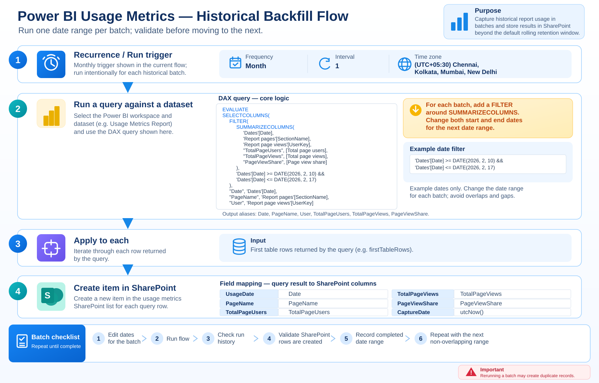

# Historical backfill: batch-by-batch procedure

This document describes the first Power Automate flow that should be run in batches because there is 5000 row limit and only once to capture historical data. It queries a selected date range from the Power BI Usage Metrics semantic model and writes the returned rows to the SharePoint history list.

## Flow illustration



This single diagram summarizes the complete flow, including the DAX batch window and SharePoint field mappings. It is a privacy-safe recreation; tenant, workspace, semantic-model, site and list identifiers are not included.

## What the flow does

1. The **Recurrence** trigger is configured with a monthly interval in the supplied definition. For a one-time backfill, run it manually/on demand where your flow setup permits, or disable the recurrence after the intended run. Do not leave an unnecessary recurring schedule enabled.
2. **Run a query against a dataset** runs a DAX query against the Usage Metrics semantic model.
3. **Apply to each** iterates over the query's first table rows.
4. **Create item** writes UsageDate, PageName, TotalPageUsers, TotalPageViews, PageViewShare, and CaptureDate to the SharePoint list.

## Full DAX query

The full query from your screenshot is maintained separately as copyable text: [Historical backfill DAX query](historical-backfill-dax-query.md).

The example batch filters dates inclusively from **10 February 2026 through 17 February 2026**:

```dax
'Dates'[Date] >= DATE(2026, 2, 10) &&
'Dates'[Date] <= DATE(2026, 2, 17)
```

Change both dates for each batch. These dates are an example from your screenshot, not a recommendation for every run.

## Suggested batch workflow

1. Decide the historical start date and the latest date you want to backfill.
2. Split the full range into manageable, non-overlapping batches (for example, one week or two weeks per batch; choose a size that works reliably with your data volume and connector limits).
3. In the DAX query, update the start and end dates for the first batch.
4. Save the flow and run it. Wait for completion.
5. Check run history for failures and confirm that the SharePoint list received the expected rows.
6. Record the batch's date range and status in a simple tracking table or checklist.
7. Move to the next non-overlapping date range and repeat until the full required period is covered.
8. Reconcile captured dates and counts against the Usage Metrics semantic model before considering the backfill complete.

### Example batch plan

| Batch | Start date | End date |
|---|---|---|
| 1 | 2026-02-01 | 2026-02-07 |
| 2 | 2026-02-08 | 2026-02-14 |
| 3 | 2026-02-15 | 2026-02-21 |
| 4 | 2026-02-22 | 2026-02-28 |

These dates illustrate the process only. Use the actual period required by your project.

## Important cautions

- **Avoid overlaps and gaps.** Use consecutive date windows and confirm each range is inclusive at both ends.
- **Duplicate records:** the historical flow shown uses Create item without a visible duplicate check. If you rerun a batch, it may create duplicates. Check before rerunning, or add a stable key and duplicate-check/upsert logic.
- **User key:** the DAX query includes `UserKey`, but the shown SharePoint Create item action does not save it. The metrics written are page/date-level fields.
- **Recurrence:** a monthly recurrence is not the same as a one-time backfill controller. Ensure the schedule is intentionally configured for how you execute the batches.
- **Batch size:** if a batch fails or approaches query/action limits, reduce the date range and retry only after checking what was already written.
- **Privacy:** use placeholders in this public example; do not publish real workspace IDs, dataset IDs, SharePoint URLs/list IDs, connection references, credentials, or personal usage data.
- **Deployment:** this JSON is a sanitized reference definition, not an import-ready Power Automate package. Configure connections and verify mappings in your environment.

## How this differs from the daily flow

The historical flow uses manually edited start/end dates to seed the SharePoint history. The daily incremental flow uses a rolling query for yesterday and checks for an existing page/date record before creating a new item. Keep the two responsibilities separate.
